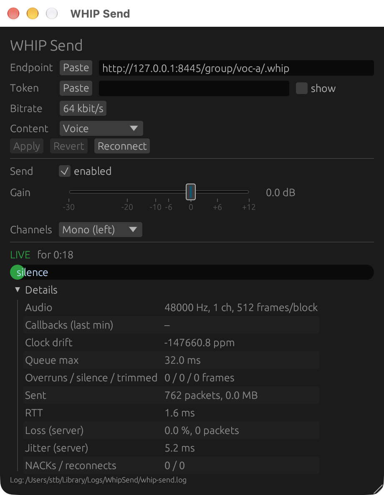

# Configuration

## Prepare Galène

Each stream needs a Galène group, and a token that may present in that group.

1. **Create the group,** e.g. with
   `galenectl create-group -group voc-a`, or with a group file. The group
   must allow Opus; that is the default.
2. **Create a token** with the `present` permission:

    ```sh
    galenectl create-token -group voc-a -permissions present
    ```

    You can also use */invite* in the Galène web interface; the token is the
    `token=` part of the generated link. Tokens expire (by default after
    24 h). Use `-duration` for longer-lived ones.
3. **Note the WHIP endpoint.** It is the group URL with `.whip` appended:

    ```
    https://galene.example.org:8443/group/voc-a/.whip
    ```

!!! tip
    A group that lets anyone present (`"wildcard-user"` with
    `"permissions": "present"`) works without a token. This is convenient for
    testing, but don't use it on a public server.

## Set up the plugin

Insert **WHIP Send** as an FX on the track or bus you want to send. It works
on mono and stereo tracks.

{ width="460" }

Its editor has three sections, from top to bottom:

1. connection and encoder settings, with **Apply**, **Revert** and
   **Reconnect**;
2. the parameters (*Send enabled*, *Send gain*, *Channels*);
3. the status: connection state, peak meter and details (see
   [Monitoring](troubleshooting.md)).

The settings fields:

| Field | Meaning |
|---|---|
| **Endpoint** | The WHIP endpoint URL, `http://` or `https://`. |
| **Token** | The bearer token. It is masked; tick *show* to check it. You can also paste a whole Galène invite link; the plugin keeps only its `token=` part. |
| **Bitrate** | Opus bitrate, 16–256 kbit/s. Default 64. |
| **Content** | *Voice* tunes Opus for speech, *Music* for music. |

The **Paste** button next to Endpoint and Token replaces the field with the
clipboard. Use it where the host keeps keystrokes from reaching the plugin,
like Reaper on macOS (see [Gotchas](live-operation.md#gotchas)).

Changes to these fields only take effect when you click **Apply**, so typing
doesn't cause reconnects. **Revert** discards your edits. **Reconnect** drops
the current session and starts a new one.

Recommended settings:

| Use | Channels | Bitrate | Content |
|---|---|---|---|
| Speech, interpretation | Mono | 32–64 kbit/s | Voice |
| Music, programme | Stereo | 96–128 kbit/s | Music |

## Parameters

These are normal plugin parameters, so they can be automated, assigned to
controllers, or set from Reaper actions and OSC:

| Parameter | Values | Effect |
|---|---|---|
| **Send enabled** | on/off | Off ends the WHIP session; on starts a new one. The track's audio is unaffected either way. |
| **Send gain** | −30 … +12 dB | Gain applied to the sent signal only. |
| **Channels** | Mono (left), Mono (right), Mono (L+R), Stereo | How the track is mapped onto the stream. On a mono track, left and right are the same. |

## Where settings are stored

Endpoint, token, bitrate and content type are saved **in the project file**,
as part of the plugin's state. Opening the project restores all feeds,
ready to go.

- Reaper's **FX presets** store the same state. Saving one preset per feed
  ("voc-a", "voc-b", …) is a quick way to set up a new project.
- **Rotating a token** means editing it in each instance and saving the
  project.

!!! warning "Project files contain the tokens"
    Reaper stores plugin state encoded, but **not encrypted**. Treat project
    files, backups, auto-saves and exported presets as secrets. Don't commit
    them to public repositories.
